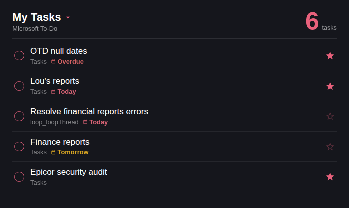

# Microsoft To-Do — iCUE Widget for Xeneon Edge

A **My Day**-style Microsoft To-Do list for the CORSAIR Xeneon Edge, visually modeled on the To-Do Android widget: dark theme, circular checkboxes, list labels, red *Today* chips, and importance stars.

Microsoft Graph has no static API keys, so this widget pairs with **[xeneon-graph-proxy](https://github.com/joshuawowk/xeneon-graph-proxy)** — a tiny LAN service that signs in once via device code and serves read-only JSON. The widget even displays the device-code on screen when sign-in is needed.

## Features

- Default list (or any list by ID) with open tasks, ordered by due date then importance
- Due chips: red *Overdue*, pink *Today*, amber *Tomorrow / this week*
- Importance stars (filled for `high`)
- **On-screen device-code sign-in** — when the proxy has no token, the widget shows the code to enter at microsoft.com/devicelogin
- Offline resilience: keeps last good data with an `offline` tag
- Responsive across all Xeneon Edge slots (multi-column on L/XL horizontal)
- Personalization: colors, background image, glass blur, transparency

## Setup

1. Deploy [xeneon-graph-proxy](https://github.com/joshuawowk/xeneon-graph-proxy) on a LAN host (Docker, port 8585)
2. Install this widget into iCUE (5.44+): `icuewidget package icue-widget-mstodo` → double-click the `.icuewidget`
3. Add the widget to a Xeneon Edge slot; set **Proxy URL** if your host differs from the default
4. If not yet signed in, the widget shows a device code — enter it at the URL displayed

## Settings

| Setting | Type | Default | Description |
|---------|------|---------|-------------|
| Proxy URL | text | `http://192.168.0.160:8585` | Where xeneon-graph-proxy runs |
| List ID | text | empty | Blank = your default To-Do list (`/api/todo/lists` to discover IDs) |
| Title | text | `My Day` | Header label |
| Max Tasks | slider | 12 | 3–30 |
| Refresh Interval | slider | 5 min | 1–30 min |
| Text / Accent / Background Color | color | white / `#e8617c` / `#15161c` | |
| Background Image + Glass Blur | media | — | Optional backdrop |
| Background Transparency | slider | 100% | |

## States

Loading · Sign-in (device code on screen) · Empty ("All done") · Error (proxy unreachable) · Content

## Privacy

The widget talks only to your own proxy on the LAN. The proxy holds read-only Graph scopes (`Tasks.Read`). No third parties.

## License

MIT
